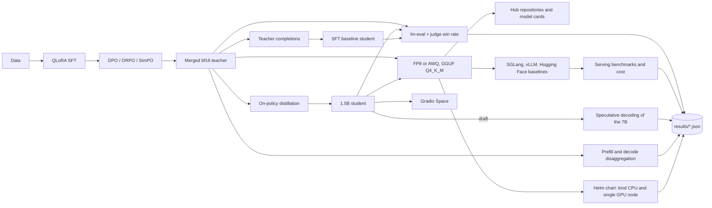

# LLM Post-Training and Inference Platform

A reproducible platform that takes an open model through alignment, distillation, quantization, and serving, with every stage evaluated. It aligns Qwen 2.5 7B Instruct with QLoRA SFT and DPO and compares ORPO and SimPO under identical settings, distills the aligned 7B model into Qwen 2.5 1.5B Instruct with on-policy reverse-KL distillation against a compute-matched SFT baseline, quantizes both for GPU and CPU serving, and serves them with SGLang and vLLM. The student also serves as a speculative decoding draft for the teacher. Heavy stages run on a SLURM cluster or on a single GPU machine, selected in `configs/compute.yaml`. Every number in the documentation is rendered from a results file written by a committed script.

## Headline results

<!-- results:headline:start -->
<!-- results:headline:end -->

## Architecture



| Component | Location | Role |
|---|---|---|
| Compute backends | `configs/compute.yaml`, `jobs/`, `slurm/`, `local/` | One set of job bodies that run under `sbatch` or directly on one machine |
| Data | `src/llmplatform/data`, `docs/DATA.md` | Pinned datasets, filters, decontamination |
| Alignment | `src/llmplatform/train` | QLoRA SFT, DPO, ORPO, SimPO, merging, scaling metrics |
| Evaluation | `src/llmplatform/eval`, `src/llmplatform/judge` | lm-evaluation-harness runs, response generation, pairwise judge |
| Distillation | `src/llmplatform/distill` | Vocabulary check, on-policy distillation, SFT baseline |
| Quantization | `src/llmplatform/quantize`, `cards`, `publish` | FP8 or AWQ, GGUF, model cards, Hub upload |
| Serving | `src/llmplatform/serve`, `bench`, `cost` | Server launchers, benchmark grid, agent traces, cost model |
| Acceleration | `src/llmplatform/speculative`, `disagg` | Draft export, speculative runs, prefill and decode disaggregation |
| Deployment | `charts/llm-serve`, `k8s`, `k6` | Helm chart, kind assets, load profile |
| Demo | `space/` | Gradio comparison of the distilled and base students |

## Quickstart

```bash
make setup      # Python 3.11 environment with uv and the locked dependencies
make up         # kind cluster serving the student GGUF with queue-depth autoscaling
make demo       # local Gradio comparison of the distilled and base students
```

`make up` needs Docker, kind, helm, and kubectl, and a published GGUF: set `MODEL_REPO`, `MODEL_FILE`, and `MODEL_SHA256` (the digest recorded in `results/quantization.json`). The Kubernetes stack runs alone on the machine, and the script stops if another kind cluster or container stack is running. `make demo` needs `GGUF_REPO` and builds its own environment from `space/requirements.txt`. `make smoke` runs the CPU pipeline on tiny models, and `make check` runs lint, type checks, and unit tests.

## How it works

### Compute backends

`configs/compute.yaml` selects `slurm` or `local`. The slurm backend takes the partition, GPU type, time limit, and maximum GPUs per job from the file; the local backend runs the same job bodies on one machine, optionally in the container defined in `docker/Dockerfile`. Long jobs checkpoint and resume: `--chain K` submits K dependent jobs under slurm, and the local runner restarts a stopped job up to `local.max_restarts` times. Every results file records the GPU model, GPU count, provider label, and the hourly price used for cost, and refuses to be written for a GPU run while `gpu_hourly_usd` is unset. `make sync` and `make pull-results` copy the working tree and the results to and from the machine named by `REMOTE_HOST` and `REMOTE_DIR` in `.env`, and record the code version in `.sync_sha`. Python environments are separate because their pins conflict; `envs/*.in` hold the top-level pins and `scripts/compile_envs.sh` resolves them to exact files.

### Data

`configs/data.yaml` pins every dataset to a commit hash. `make data` builds the SFT set, the preference set, and the distillation prompts, filters by token length, and removes any row that duplicates or nearly duplicates a judge prompt or a benchmark question, using exact matching and MinHash. `make judge-prompts` draws the 300 judge prompts with a fixed seed. Provenance and filters are documented in `docs/DATA.md`.

### Alignment

SFT, DPO, ORPO, and SimPO share one trainer module and differ only in the objective. The base model is loaded in 4-bit NF4 with double quantization and bf16 compute, with LoRA adapters on all linear layers, and DeepSpeed ZeRO-2 shards optimizer state and gradients across data-parallel ranks (`configs/accelerate/zero2.yaml`). The preference objectives start from the merged SFT checkpoint and use identical optimizer, length, and seed settings. Adapters are merged into bf16 checkpoints that serving engines load directly.

### Evaluation and judge

`scripts/eval.py benchmarks` runs IFEval, GSM8K (5-shot), MMLU (5-shot), ARC Challenge (25-shot), HellaSwag (10-shot), and TruthfulQA MC2 (0-shot) with lm-evaluation-harness and the chat template. `scripts/eval.py generate` writes greedy responses of at most 1,024 new tokens to the judge prompts. `scripts/eval.py judge` compares candidate and reference with `openai/gpt-oss-120b` on Groq at temperature 0. Each pair is judged twice with positions swapped: a win needs both orders to prefer the candidate, a loss needs both to prefer the reference, and anything else is a tie. The win rate is `(wins + 0.5 * ties) / n` with a 2,000-resample bootstrap interval, reported next to the mean response length. Judgments are cached on disk by the SHA-256 of the judge model, template version, prompt, and both responses.

### Distillation

`scripts/check_vocab.py` verifies that the teacher and student tokenizers are identical and shorter than both padded embedding sizes. When the padded sizes differ, the teacher's embeddings are resized to the student's and its logits on real tokens are compared before and after. `scripts/distill.py opd` then runs TRL's `DistillationTrainer` with reverse KL on-policy distillation, float32 student weights with bf16 autocast, time-based checkpoints, and a guard on `completions/clipped_ratio`. A GPU-hour ledger accumulates across chained jobs. The baseline generates teacher completions through SGLang and trains the student with SFT until it has spent the same GPU-hours.

### Quantization and publishing

GPUs with FP8 (Ada and Hopper) use the server's online FP8; older GPUs use AWQ 4-bit weights from llm-compressor. The teacher, the distilled student, and the base student are converted to Q4_K_M GGUF with llama.cpp and checked with five prompts. Quantized variants are evaluated on IFEval and the judge prompts. Model cards are rendered from results files and refuse to render unless the base license is Apache 2.0. Uploads create private repositories first.

### Serving and benchmarks

`src/llmplatform/serve` builds SGLang, vLLM, and llama.cpp commands and runs servers as managed processes. `scripts/bench.py grid` drives `sglang.benchmark.serving` and `vllm bench serve` over input and output lengths of 512/256 and 2,048/512, concurrency 1, 4, 16, and 64, 500 prompts per cell, and three seeded repetitions, and reports medians. The Hugging Face baseline uses static batching at batch sizes 1, 8, and 32. The cost model picks the highest concurrency whose p95 time to first token is at most 500 ms and p95 inter-token latency is at most 50 ms, and computes `gpu_hour_usd / 3600 / output_tokens_per_second * 1e6`.

### Agent workloads

`src/llmplatform/bench/agent_traces.py` builds multi-turn conversations from the real system prompts and tool schemas placed in `eval/agent_traces/source/`. Every turn repeats the previous turn's messages and extends them, so the shared prefix grows. The replay flushes the prefix cache between runs and derives the hit rate from engine counters.

### Speculative decoding

`scripts/export_draft.py` pads each draft's embeddings with zero rows to the target's padded size and verifies that real-token logits are unchanged and that the argmax never lands in a padded row. SGLang runs the teacher with a draft at 3, 5, and 8 verified tokens. Outputs for 50 prompts must equal non-speculative decoding at temperature 0, and any mismatch fails the experiment.

### Prefill and decode disaggregation

Two GPUs on one node run a prefill server, a decode server, and the SGLang router in prefill-decode mode, with NIXL as the transfer engine. The baseline is two colocated replicas behind the same router. Mixed traffic of long prompts and chat requests arrives at fixed rates.

### Kubernetes

`charts/llm-serve` deploys a llama.cpp GGUF on CPU or SGLang on one GPU with startup, readiness, and liveness probes, a checksum-verified model download, a disruption budget, a ServiceMonitor, and a KEDA trigger on queue depth (threshold 2, one to three replicas, 120 s cooldown). `make k8s-up` builds a kind cluster with pinned monitoring and KEDA charts. `docs/gpu_validation.md` describes the single-GPU procedure.

### Demo

`space/` is a Gradio app that serves the distilled and base students side by side through `llama-cpp-python` on the Space's CPU, with a per-session rate limit and a cap on new tokens. A free-tier Space sleeps when idle.

## Evaluation

Each experiment is one make target. Tables below are rendered by `make results` from `results/*.json`, and `make results-check` fails when a table differs from its file. Every table states the hardware it was measured on.

### Model quality: base, SFT, DPO, ORPO, SimPO, teacher, students, quantized variants

Run `make eval CHECKPOINT=<name>`, `make generate CHECKPOINT=<name>`, and `make judge CANDIDATE=<name>` for each checkpoint in `configs/eval/e1.yaml`, `make eval-variant CHECKPOINT=<name>` for quantized variants, then `make e1-summary`.

<!-- results:e1:start -->
<!-- results:e1:end -->

### Data-parallel scaling

`make scaling` runs 60 DPO optimizer steps at 1, 2, 4, and 8 GPUs of one node with identical per-device batch size and discards the first 10. Efficiency is `throughput_N / (N * throughput_1)`.

<!-- results:e2:start -->
<!-- results:e2:end -->

### Distillation against the compute-matched baseline

`make teacher-gen`, `make distill`, `make sft-baseline`, then `make e3`. Retention is the distilled student's win rate divided by the teacher's.

<!-- results:e3:start -->
<!-- results:e3:end -->

### Serving: SGLang, vLLM, Hugging Face, and cost

`make serve-bench` runs the grid for the teacher and the student in bf16 and quantized form.

<!-- results:e4:start -->
<!-- results:e4:end -->

### Agent workloads and prefix caching

`make agent-traces` once, then `make agent-bench` for SGLang and vLLM with prefix caching on and off at concurrency 4, 16, and 64.

<!-- results:e8:start -->
<!-- results:e8:end -->

### Speculative decoding

`make speculative` measures the base student and the distilled student as drafts for the teacher at concurrency 1, 4, and 16.

<!-- results:e6:start -->
<!-- results:e6:end -->

### Prefill and decode disaggregation

`make disagg` runs both setups on the same two GPUs.

<!-- results:e7:start -->
<!-- results:e7:end -->

### Kubernetes autoscaling on CPU

`make k8s-up`, `make k8s-load`, `make k8s-report KIND=cpu`, `make k8s-down`. The run ramps one to eight concurrent chat users over ten minutes against the llama.cpp backend on kind.

<!-- results:e5_cpu:start -->
<!-- results:e5_cpu:end -->

### Kubernetes autoscaling on a GPU node

`docs/gpu_validation.md` lists the commands; the results file is written with `make k8s-report KIND=gpu` and labeled with the GPU and the provider.

<!-- results:e5_gpu:start -->
<!-- results:e5_gpu:end -->

## Design decisions

Decisions and the alternatives considered are recorded in [DECISIONS.md](DECISIONS.md): the compute abstraction, why ZeRO-2 and not ZeRO-3, objective-identical preference runs, position-swapped judging, the vocabulary alignment of the teacher, the compute-matched baseline rule, time-based checkpoints, FP8 versus AWQ, the SLO definition for disaggregation, and the results policy.

## Limitations

- The judge is a language model. Its preferences estimate quality on 300 prompts, with a bootstrap interval that reflects prompt sampling only, and win rates depend on the judge model and prompt template.
- Quantized variants are evaluated on IFEval and the judge prompts only, not on the full benchmark suite.
- The throughput grid uses random-token prompts, which exercise the engines but not realistic output distributions. Speculative decoding therefore uses real chat prompts instead.
- The Hugging Face baseline measures static batches; concurrency equals batch size and all sequences of a batch share a time to first token.
- Agent traces use synthetic assistant turns and synthetic tool results so that prefixes are identical across runs; only the system prompts and tool schemas are real.
- ORPO and SimPO use the experimental trainers of the pinned TRL release.
- The student trains with float32 weights and bf16 autocast, which costs about 24 GB for the 1.5B model; `student_training.dtype: bfloat16` trades that memory for possible rounding loss at a learning rate of 1e-6.
- The disaggregation SLO checks chat-class time to first token and overall inter-token latency; long-prompt time to first token is reported but not part of the SLO.
- A kind run on CPU shows deployment mechanics and autoscaling, not GPU performance. Every Kubernetes table names its hardware.
- Prompt lengths in the disaggregation workload are approximate (about one token per word); measured prompt lengths are recorded in the results.

## Repository layout

```
configs/      compute, data, models, train, distill, eval, serve, quantize, publish, cost
src/llmplatform/
  common/ data/ train/ eval/ judge/ distill/ quantize/ cards/ publish/
  serve/ bench/ speculative/ disagg/ cost/ smoke/
jobs/         backend-independent job bodies
slurm/        sbatch submission wrapper
local/        single-machine runner and container runner
docker/       base image for the local backend
envs/         per-environment requirement sources and pinned files
charts/llm-serve/   Helm chart
k8s/ k6/      kind, monitoring, KEDA values, dashboard, load profile
space/        Gradio demo
scripts/      thin command-line entry points
eval/         judge prompts and agent trace inputs
docs/         DATA.md, architecture.md, runbook.md, compute.md, gpu_validation.md
results/      JSON artifacts written by the scripts
tests/        unit and tiny-model tests
```
