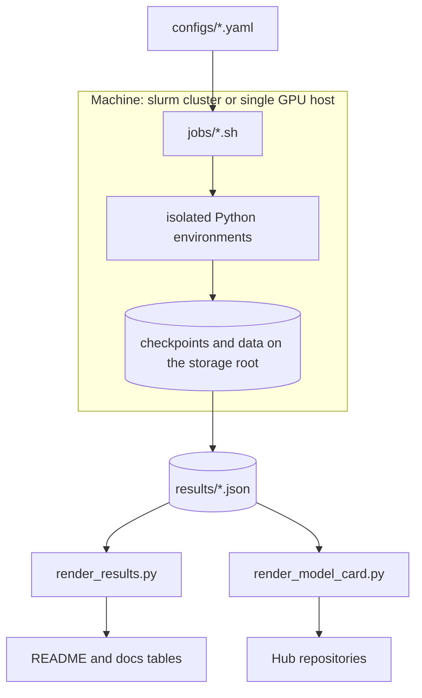

# Architecture

The platform is a chain of stages whose outputs are checkpoints on the storage root and measurements in `results/`.

## Stages and files

| Stage | Input | Output |
|---|---|---|
| Data | pinned Hub datasets | `sft.jsonl`, `preferences.jsonl`, `distillation_prompts.jsonl`, `eval/judge_prompts.jsonl`, `results/data_manifest.json` |
| SFT, DPO, ORPO, SimPO | prepared data, base model | adapters and merged bf16 checkpoints |
| Evaluation | checkpoints | `results/e1/<checkpoint>.json`, `results/e1_summary.json` |
| Distillation | teacher, student, prompts | `results/vocab_check.json`, distilled student, ledger |
| SFT baseline | teacher completions, ledger | baseline student |
| Quantization | checkpoints | AWQ checkpoints or online FP8, Q4_K_M GGUF, `results/quantization.json` |
| Serving experiments | servers | `results/e4_serving.json`, `e6_speculative.json`, `e7_disaggregation.json`, `e8_agent_workloads.json` |
| Kubernetes | chart, GGUF | `results/e5_k8s_cpu.json`, `e5_k8s_gpu.json` |

## Why the Python environments are separate

The training stack, the distillation stack with TRL 1.x and Transformers 5, the evaluation harness, SGLang, vLLM, and the quantization tools pin incompatible versions of PyTorch, Transformers, and each other. One virtual environment per concern, built from exact files in `envs/`, removes the conflicts. The platform package itself is pure Python with light dependencies and is imported from the repository through `PYTHONPATH`, so every environment runs the same code.

## Results files

Every result is one JSON file with a schema version, a run id, the code version (the git SHA, or the `.sync_sha` value on a synced machine), the config path and its SHA-256, the Python version and package versions, the hardware record (GPU model, GPU count, provider label, hourly price), the metrics, and notes. `scripts/render_results.py` is the only writer of README result tables.

## Serving processes

`llmplatform.serve.launch` starts a server in its own process group, waits for `/health`, runs a command with the server addresses substituted for `{base_url}`, `{openai_url}`, and `{metrics_url}`, and stops the server whether or not the command succeeds. The benchmark, agent, speculative, and disaggregation jobs all use it, directly or through `ManagedProcess`.
